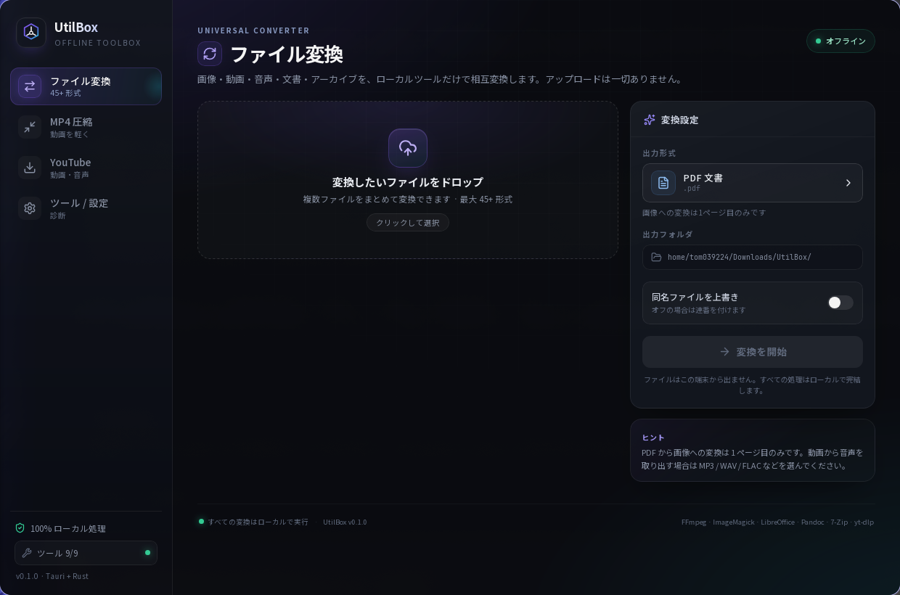
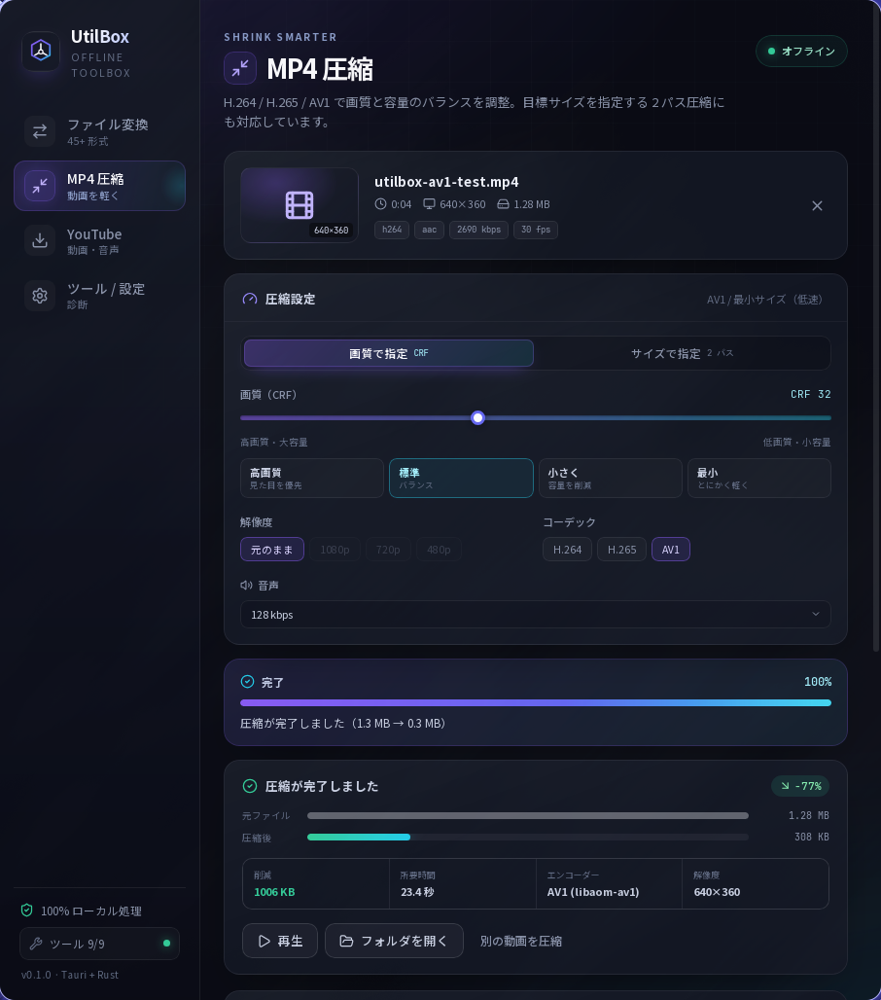
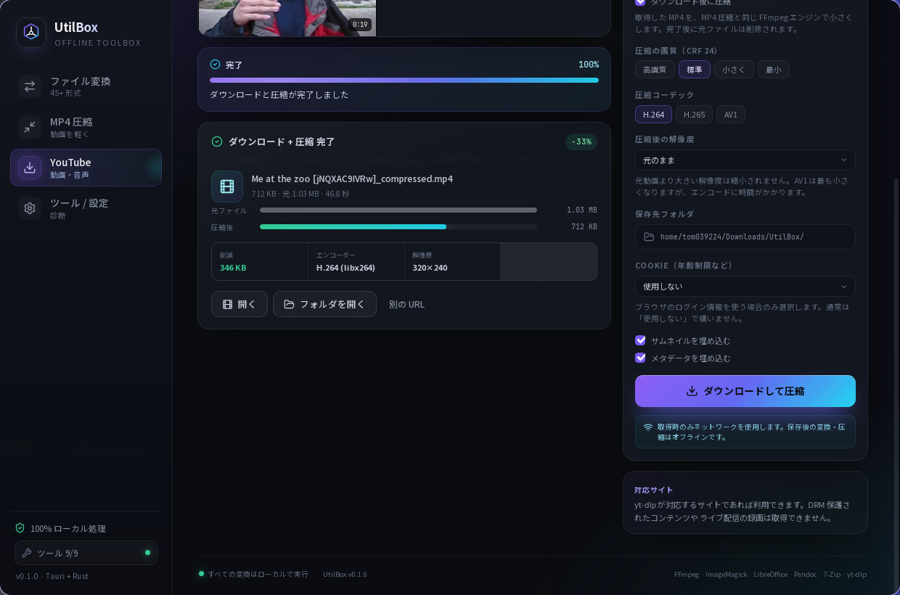

# UtilBox

**オフラインで完結する統合ツールボックス** — Tauri 2 + Rust + React。

ファイル変換・MP4 圧縮・YouTube ダウンロードを 1 つのデスクトップアプリにまとめました。
変換処理はすべて端末内の CLI ツール（FFmpeg / ImageMagick / LibreOffice / Pandoc / 7-Zip / Poppler）で実行され、
ファイルが外部に送信されることはありません。ネットワークを使うのは **YouTube などの取得時だけ** です。



---

## 機能

| モジュール | できること | 使用ツール |
| --- | --- | --- |
| **ファイル変換** | 画像・動画・音声・文書・アーカイブを 45+ 形式へ相互変換。複数ファイルの一括変換、変換経路の自動探索（最大 3 ステップ） | FFmpeg, ImageMagick, LibreOffice, Pandoc, 7-Zip, Poppler |
| **MP4 圧縮** | CRF 画質指定 / 目標サイズ 2 パス、H.264・H.265・AV1 出力、解像度縮小、音声ビットレート、進捗・速度・残り時間表示 | FFmpeg / FFprobe |
| **YouTube ダウンロード** | 動画（最大 4K）・音声のみ（MP3 / M4A / Opus）、サムネイル・メタデータ埋め込み、Cookie 利用、進捗表示。**ダウンロード直後の MP4 圧縮**にも対応 | yt-dlp + FFmpeg |
| **ツール診断** | 同梱 / システムツールの検出、バージョン表示、yt-dlp のアプリ内更新 | — |

ファイル変換は [p2r3/convert](https://github.com/p2r3/convert)（convert.to.it）の
「媒体をまたいで何でも変換する」という思想に着想を得ています。本アプリはそのコードを同梱・改変したものではなく、
同じ系統の CLI ツール群を Rust から統合した独立実装です。

### 対応形式（変換）

- **画像**: PNG, JPG, WebP, GIF, BMP, TIFF, ICO, AVIF, HEIC, TGA, PPM（SVG は入力のみ） / PDF
- **音声**: MP3, WAV, FLAC, OGG, Opus, M4A, AAC, WMA, AIFF
- **動画**: MP4, MKV, WebM, AVI, MOV, M4V, TS, FLV, WMV（GIF への変換・GIF からの変換も可）
- **文書**: PDF, DOCX, DOC, ODT, RTF, TXT, MD, HTML, EPUB
- **アーカイブ**: ZIP, 7z, TAR, GZ, XZ, BZ2

文書 → 画像、Markdown → PDF、動画 → 音声、画像 → PDF などは複数ツールを自動で連結します。
例: `DOCX → PDF（LibreOffice）→ PNG（Poppler）`

### AV1 出力について

MP4 圧縮では H.264 / H.265 に加えて **AV1** を選択できます。

- 同梱 FFmpeg では `libaom-av1` を使用します（どこでも動作しますがエンコードは低速）。
- アプリデータの `bin/` に `libsvtav1` を含む FFmpeg を置くと、そちらを優先します。
- AV1 は同程度の画質で H.264 / H.265 より小さくなりやすい一方、エンコード時間が長く、
  古いプレイヤーや一部の編集ソフトでは再生できない場合があります。



### ダウンロード後の圧縮

YouTube ダウンロード設定の「ダウンロード後に圧縮」をオンにすると、取得した MP4 を
**MP4 圧縮と同じ FFmpeg エンジン**でそのまま小さくできます。

- 画質プリセット（CRF）・コーデック（H.264 / H.265 / AV1）・解像度を指定できます。
- 進捗バーはダウンロード（0–85%）と圧縮（86–100%）を連続して表示します。
- 圧縮に成功すると、圧縮前の元ファイルは自動的に削除されます。
- 圧縮に失敗した場合は元ファイルを保持したままエラーを表示します。
- 音声のみのダウンロードでは圧縮を利用できません（動画モードのみ）。



---

## オフライン設計

```
┌──────────────────────────────┐
│ React UI (WebView)           │
│  変換 / 圧縮 / DL / 設定      │
└──────────────┬───────────────┘
               │ Tauri IPC (invoke / events)
┌──────────────▼───────────────┐
│ Rust バックエンド              │
│  ├─ 変換プランナー (3 step)    │
│  ├─ ジョブ管理 / 進捗 / 取消   │
│  └─ ツール解決                 │
└──────────────┬───────────────┘
               │ プロセス実行（シェル不使用）
┌──────────────▼───────────────┐
│ 同梱 or システムの CLI         │
│  FFmpeg / ImageMagick /       │
│  LibreOffice / Pandoc /       │
│  7-Zip / Poppler / yt-dlp     │
└──────────────────────────────┘
```

- **アップロードなし**: 変換・圧縮はローカルファイルのみ。
- **同梱バイナリを優先**: `src-tauri/binaries/` の FFmpeg / Pandoc / yt-dlp を使用。
  無い場合は PATH 上のツールを自動検出。
- **yt-dlp だけ更新可能**: YouTube の仕様変更に追従するため、設定画面から最新バイナリを
  アプリデータフォルダへ保存（この操作のみ通信）。
- **取得時のみ通信**: YouTube の解析・ダウンロード以外にネットワークアクセスはありません。

---

## 開発

### 必要なもの

- Node.js 20+ / [Bun](https://bun.sh/)
- Rust 1.77+
- Tauri 2 の OS 依存パッケージ（Linux: `webkit2gtk-4.1`, `gtk3`, `libsoup3` など）
- 変換ツール（同梱しない場合）: `ffmpeg`, `ffprobe`, `magick`, `libreoffice`,
  `pandoc`, `7z`, `pdftoppm`, `pdftotext`

### 起動

```bash
bun install
bun tauri dev
```

### ビルド

```bash
# 同梱 sidecar を取得（初回のみ / ネットワーク使用）
./scripts/fetch-sidecars.sh

# リリースビルド（deb + AppImage）
bun tauri build --bundles deb,appimage
```

Linux では `src-tauri/target/release/bundle/deb/` と `bundle/appimage/` に
インストーラが生成されます。同梱ツールを含むため、ファイルサイズは大きくなります
（deb 約 130 MB / AppImage 約 230 MB）。
macOS / Windows では各 OS 上でビルドしてください（Tauri のクロスビルド非対応）。

### テスト

```bash
cd src-tauri
cargo test          # プランナー・進捗解析・メタデータ解析・AV1 設定など 43 テスト
cargo clippy
```

GUI を起動せずエンジンを検証するための CLI ハーネスもあります。

```bash
cd src-tauri
cargo run --bin utilbox-cli -- tools
cargo run --bin utilbox-cli -- formats
cargo run --bin utilbox-cli -- convert png /tmp/out input.jpg
cargo run --bin utilbox-cli -- probe input.mp4
cargo run --bin utilbox-cli -- compress input.mp4 out.mp4 --crf 26 --height 720
cargo run --bin utilbox-cli -- compress input.mp4 out-av1.mp4 --codec av1 --crf 32
cargo run --bin utilbox-cli -- ytinfo "https://www.youtube.com/watch?v=..."
cargo run --bin utilbox-cli -- download "https://www.youtube.com/watch?v=..." /tmp/out --compress --codec av1 --crf 32
```

---

## 構成

```
UtilBox/
├─ src/                        # React UI
│  ├─ App.tsx
│  ├─ components/              # Dropzone, FormatPicker, Progress, Sidebar …
│  ├─ pages/                   # Convert / Compress / Download / Settings
│  ├─ lib/api.ts               # Tauri コマンド・イベント型定義
│  └─ styles.css
├─ src-tauri/
│  ├─ src/
│  │  ├─ lib.rs                # Tauri セットアップ / 状態
│  │  ├─ commands.rs           # IPC コマンド
│  │  ├─ convert.rs            # 形式レジストリ + 変換プランナー + 実行
│  │  ├─ compress.rs           # FFmpeg 圧縮（CRF / 2 パス）
│  │  ├─ download.rs           # yt-dlp 解析・DL・自己更新
│  │  ├─ job.rs                # ジョブ / 進捗 / キャンセル
│  │  ├─ process.rs            # 子プロセス実行・出力ストリーム
│  │  ├─ tools.rs              # ツール検出（同梱 → PATH）
│  │  └─ bin/utilbox-cli.rs    # ヘッドレステスト用 CLI
│  ├─ binaries/                # 同梱 sidecar（fetch スクリプトで取得）
│  └─ tauri.conf.json
├─ scripts/fetch-sidecars.sh
└─ README.md
```

---

## Android 版（Pixel 8a など arm64）

React UI と Rust エンジンはそのままに、**メディア中心**の機能を Android へ移植しています。

| 機能 | Android |
| --- | --- |
| 画像・音声・動画の変換（27 形式） | ✅ |
| MP4 圧縮（H.264 / H.265 / AV1） | ✅ |
| YouTube ダウンロード / 文書変換 / アーカイブ変換 | ❌（デスクトップのみ） |

- FFmpeg は arm64 向けにソースからビルドし、`libffmpeg.so` / `libffprobe.so` として APK に同梱します
  （アプリのデータ領域からは実行できないため、`nativeLibraryDir` から起動します）。
- ファイルは Android のピッカーで選び、結果は `Download/UtilBox/` に保存されます（ストレージ権限は不要）。
- リリース版はネットワーク権限を持ちません。

```bash
# 1. FFmpeg をビルド（初回のみ。NDK r27 / cmake / ninja / nasm が必要。30〜60 分）
./scripts/build-android-ffmpeg.sh

# 2. APK をビルドして端末へ
export ANDROID_HOME=~/Android/Sdk NDK_HOME=~/Android/Sdk/ndk/27.2.12479018
bun tauri android build --debug --target aarch64 --apk
adb install -r src-tauri/gen/android/app/build/outputs/apk/universal/debug/app-universal-debug.apk
```

同梱の FFmpeg は x264 / x265 を含む **GPL-3.0-or-later** ビルドです（ライセンスは下の「ライセンス / クレジット」を参照）。

---

## 既知の制限

- PDF → 画像 / 文書 → 画像は **1 ページ目のみ**（複数ページ出力は未対応）。
- スキャン PDF の OCR は未対応（テキスト抽出が空になる場合があります）。
- HEIC / AVIF の可否は ImageMagick のデリゲートに依存します。
- GZ / XZ / BZ2 への変換は「単一ファイルのアーカイブ」のみ。
- プレイリスト URL は先頭の動画のみ取得します。
- DRM 保護コンテンツ、ライブ配信の録画は取得できません。
- ダウンロード後の圧縮は動画モードのみです。圧縮には追加の時間がかかり、成功時は元ファイルを削除します。
- 目標サイズ 2 パスはビットレート計算による近似です（音声コピー時は誤差が増えます）。
- AV1 出力は `libaom-av1`（同梱 FFmpeg）を使用するため、H.264 / H.265 より時間がかかります。
  `libsvtav1` 入りの FFmpeg をアプリデータの `bin/` に置くと高速化できます。
- ハードウェアエンコーダーは未使用（libx264 / libx265 / libaom-av1）。

## ライセンス / クレジット

© 2026 Kirsikka (GitHub: Tom039224)

| 範囲 | ライセンス |
| --- | --- |
| 下記以外のすべて | **BSD 3-Clause**（[`LICENSE`](LICENSE)） |
| ファイル変換機能（`convert.rs` / `ConvertPage.tsx` / `FormatPicker.tsx` / `convert.css`） | **GPL-2.0-only**（[`LICENSES/GPL-2.0-only.txt`](LICENSES/GPL-2.0-only.txt)） |
| 同梱・利用する外部ツール | 各ツールのライセンス（[`THIRD_PARTY_NOTICES.md`](THIRD_PARTY_NOTICES.md)） |

- ファイル変換機能は [p2r3/convert](https://github.com/p2r3/convert)（GPL-2.0）の
  「媒体をまたいで何でも変換する」という発想に基づくため、同じ GPL としています。
  上流が「or later」を付けていないので **GPL-2.0-only** です。
- 配布するアプリは BSD のファイルと GPL のファイルを一緒にビルドするため、**配布物全体は GPL-2.0-only** として扱います。
- 同梱の FFmpeg（x264 / x265 入り）は別プロセスとして起動する **GPL-3.0-or-later** のバイナリです。
  アプリ本体のライセンスには影響しませんが、配布時は対応するソースを提供する必要があるため、
  GitHub Releases に **ソース一式**（`utilbox-ffmpeg-android-source-*.tar.xz`）を添付しています。
- 詳細は [`LICENSING.md`](LICENSING.md)。各ソースファイルには `SPDX-License-Identifier` を付けています。

主な外部ツールのライセンス:

| ツール | ライセンス |
| --- | --- |
| FFmpeg / FFprobe | GPL-3.0-or-later（x264 / x265 入りビルド） |
| ImageMagick | ImageMagick License |
| LibreOffice | MPL-2.0 |
| Pandoc | GPL-2.0-or-later |
| 7-Zip | LGPL-2.1+（unRAR 制限あり） |
| Poppler | GPL-2.0-or-later |
| yt-dlp | Unlicense |

着想元: [p2r3/convert](https://github.com/p2r3/convert) — “Truly universal online file converter”.
